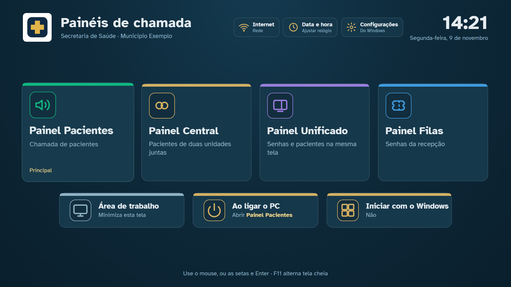
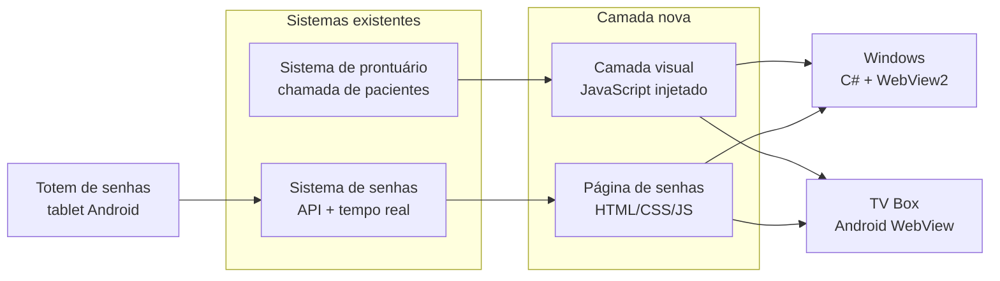
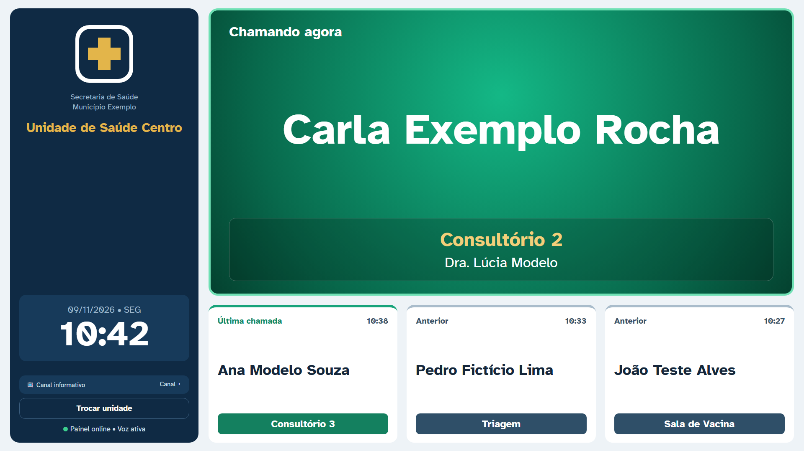
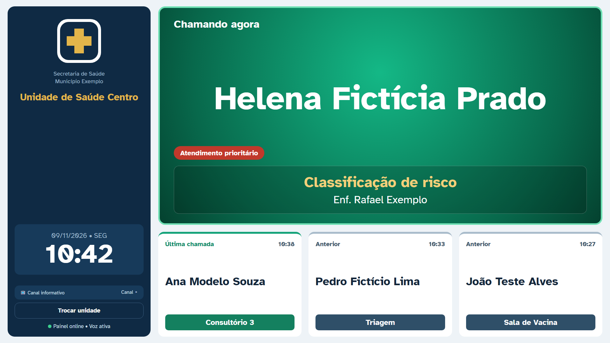
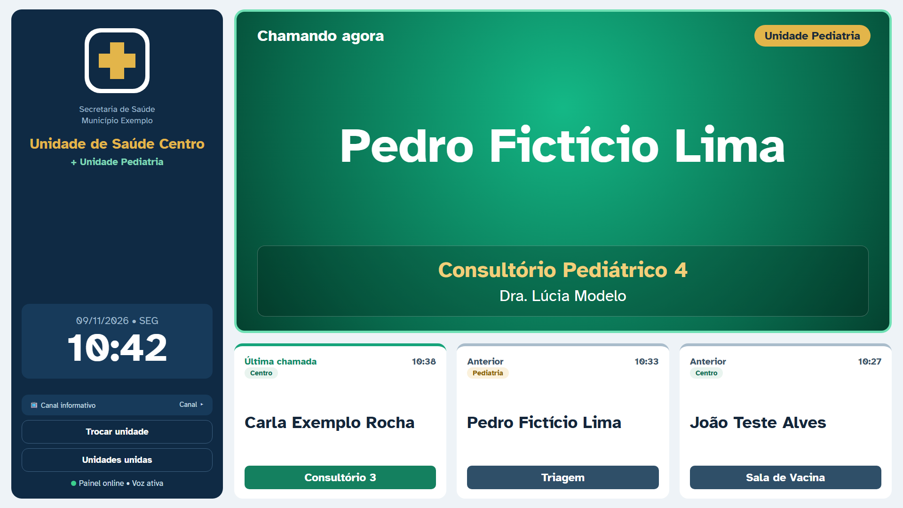
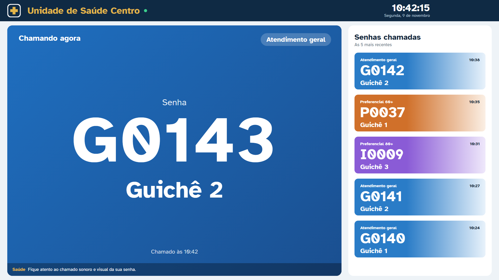
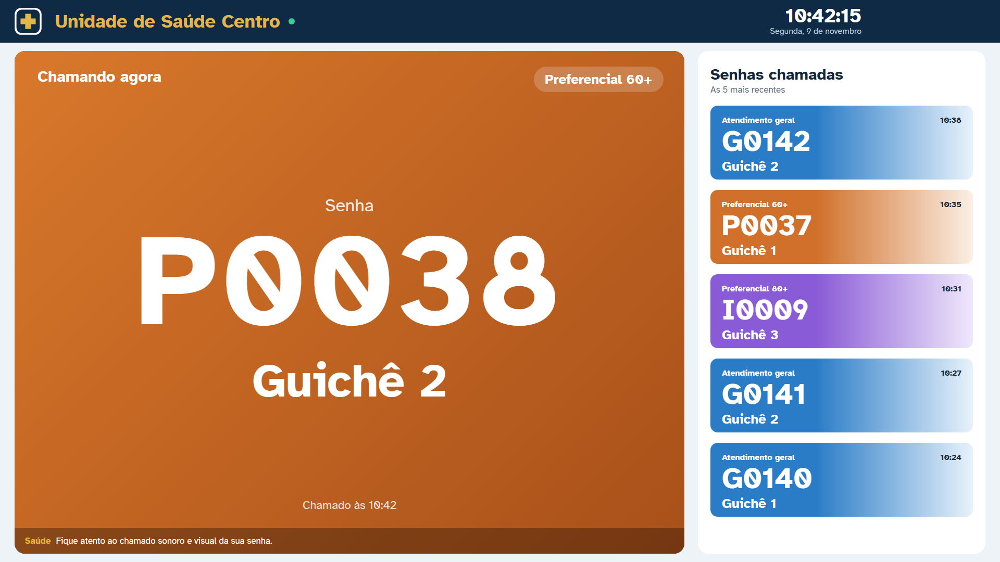
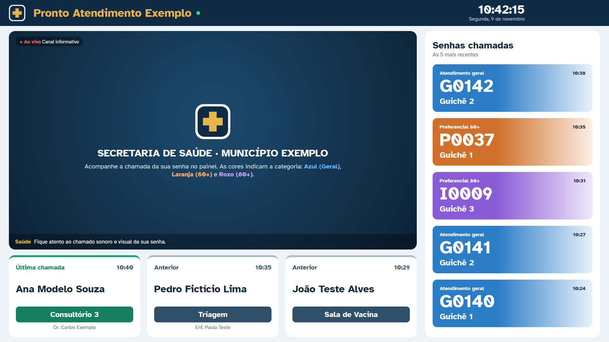
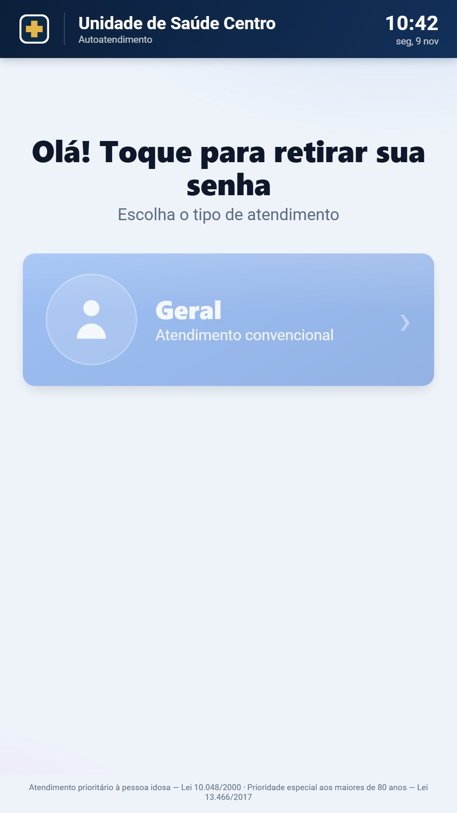

# Painéis de chamada para a rede pública de saúde

> **Projeto de portfólio.** O código-fonte não está disponível neste repositório.
> As telas abaixo são **demonstrações com dados fictícios**: os nomes de pacientes, profissionais, unidades e município são inventados, e os logos foram substituídos por um ícone genérico.
>
> **Este projeto foi feito com vibe code.** Todo o código foi escrito por IA (Claude Code), conduzida por mim em conversas. Meu papel foi definir o problema e as regras, decidir o que entrava, testar no equipamento real e implantar. A seção [Como foi feito](#como-foi-feito) explica isso em detalhe.

---

## O problema

As unidades de saúde já usavam dois sistemas:

- o **sistema de prontuário**, que chama o paciente pelo nome para o consultório;
- o **sistema de senhas**, que chama a senha retirada na recepção para o guichê.

Cada um tinha o próprio painel de TV. Os painéis eram antigos, tinham visuais diferentes e problemas do dia a dia:

- **A fila não zerava:** a lista de senhas do dia anterior continuava na tela na manhã seguinte.
- **TV Box sem voz:** em muitas TV Boxes baratas, a chamada aparecia sem som, porque o aparelho não tem sintetizador de voz.
- **Uma unidade por TV:** unidades que dividem a mesma sala de espera, como uma clínica geral e uma pediatria, precisavam de duas TVs.
- **Recepção com duas telas:** quem chama senha e paciente precisava de dois painéis lado a lado.
- **Instalação manual:** cada TV Box era configurada à mão, e o launcher de fábrica voltava ao religar o aparelho.

## A solução

Um conjunto de **painéis de chamada com o mesmo visual**, que rodam no **PC (Windows)** e na **TV Box (Android)**. **Os sistemas originais não foram alterados.** Os painéis abrem esses sistemas e mudam só a apresentação: uma camada visual por cima do sistema de prontuário e uma página própria que conversa com o sistema de senhas.

**Uma única base de layout.** O visual de cada painel fica em arquivos web compartilhados. O executável Windows usa esses arquivos direto, e o projeto Android copia os mesmos arquivos a cada compilação. Assim, uma mudança feita e testada no PC chega igual à TV Box.

---

## Os painéis

### Painel Pacientes

- **Chamada atual em destaque:** nome do paciente, sala e profissional, com aviso sonoro e voz em português.
- **Histórico:** as três chamadas anteriores ficam embaixo.
- **Barra lateral:** relógio, TV ao vivo e troca de unidade.

Atendimento prioritário ganha um selo próprio:

### Painel Central: duas unidades numa TV só

- **Duas unidades na mesma tela:** o painel faz login numa segunda unidade, em segundo plano, e mistura as chamadas das duas.
- **Selo da unidade:** "Chamando agora" mostra qual unidade chamou, e cada cartão do histórico tem a sua etiqueta.
- **Uma voz por vez:** as chamadas das duas unidades entram numa **fila única**, para uma voz não falar por cima da outra.
- **União salva:** ao religar, as duas unidades voltam sozinhas.
- **Reinício diário:** às 3h, com a fila vazia, o painel recarrega, libera memória e apaga as chamadas do dia anterior.

### Painel Filas (senhas)

- **Cor por categoria:** Geral em azul, Preferencial 60+ em laranja e Preferencial 80+ em roxo.
- **Chamada em tela cheia:** a senha chamada ocupa a tela, e o histórico das últimas cinco fica ao lado.
- **Tempo real:** as chamadas chegam por WebSocket.
- **Virada do dia:** o painel percebe a troca de data e zera a fila sozinho, mesmo que fique ligado a noite toda.

### Painel Unificado: senhas e pacientes na mesma tela

- **Para unidades pequenas:** uma TV só mostra a recepção (senhas) e os consultórios (pacientes).
- **Como funciona:** o sistema de prontuário roda escondido e repassa as chamadas para a página de senhas, que mostra as duas coisas.

### Tela inicial e totem de senhas

- **Tela inicial (PC e TV Box):**
  - um cartão por painel, com navegação por setas do controle remoto;
  - atalhos para internet (com o sinal do Wi-Fi), data e hora e configurações.
  - Na TV Box, ela substitui o launcher de fábrica.
- **Totem:** app para tablet em que o cidadão retira a senha (Geral, 60+ ou 80+) e o cupom sai na impressora térmica.

---

## Desafios técnicos

| Desafio | Como foi resolvido |
|---|---|
| Mudar o visual de um sistema web sem acesso ao código dele | Executável C# com **WebView2** que injeta JavaScript ao carregar a página. O script lê os dados da tela original e redesenha tudo por cima |
| TV Box com navegador antigo (equivalente ao Chrome 80) | Camada de compatibilidade de CSS e JS. Nada de recursos modernos, como `gap` em flex, `inset` e `color-mix` |
| TV Box sem sintetizador de voz | Ponte Java ↔ JavaScript que usa a voz do Android e, se não houver, uma voz online de reserva |
| Duas unidades na mesma tela | Segunda sessão num quadro oculto, com login automático, reconexão e fila de voz compartilhada |
| Cliques por script ignorados pelo framework da página | Conversão automática para os eventos que o framework espera |
| Quatro apps Android com o mesmo código | Um projeto Gradle com **product flavors**, um por painel. O layout é sincronizado das pastas do Windows a cada build |
| Instalação em várias TV Boxes | Instalador `.bat`/PowerShell via ADB pela rede: instala os apps, troca o launcher e libera as permissões |
| Atualizar sem perder o login salvo | Mesma assinatura e mesmo pacote dos apps antigos, para a atualização ser feita por cima |

**Tecnologias:**
- C# (WinForms + WebView2);
- JavaScript, HTML e CSS;
- Java (Android WebView, TextToSpeech, MediaPlayer);
- Gradle;
- WebSocket;
- HLS (hls.js);
- ADB e PowerShell.

---

## Como foi feito

Todo o código foi escrito com **Claude Code**, um agente de IA para programação, a partir de conversas comigo. Não escrevi as linhas de código. O meu trabalho foi:

- **Definir o problema e o resultado esperado:** o que cada painel mostra, o que acontece ao ligar a TV Box, como a fila deve se comportar na virada do dia.
- **Impor regras de trabalho, seguidas em todas as sessões:**
  - backup antes de qualquer alteração;
  - testes só numa cópia, **sem derrubar o painel em uso** nas unidades;
  - **nenhum dado de paciente gravado em disco**: nada de logs, prints ou arquivos de teste com nomes reais;
  - nunca deixar versão de depuração ou porta de depuração aberta em produção.
- **Testar no equipamento real:** PCs das unidades e TV Boxes de modelos diferentes.
- **Validar com quem usa:** ajustar o que os usuários apontavam.
- **Decidir:** aprovar o visual, apontar erros, pedir correções e dizer quando estava pronto.
- **Implantar e documentar:** instalação nas TV Boxes, guias para o usuário final, documentação técnica para a equipe de programação e vídeos tutoriais.

A IA acelerou muito a escrita do código. A qualidade do resultado veio de saber **o que pedir, como testar e quando não aceitar** uma solução.

---

## Resultado

- **Quatro painéis, uma tela inicial e um totem,** com o mesmo visual no PC e na TV Box.
- **Problemas antigos resolvidos:** a fila agora zera sozinha, a TV Box sem voz passou a falar, e duas unidades cabem numa TV só.
- **Implantação:** TV Boxes de vários modelos instaladas pela rede, com a tela inicial fixa e atualização sem perder os logins.
- **Material de apoio:** documentação técnica entregue à equipe de programação, guias para o usuário final e um vídeo tutorial por painel.

---

Projeto de portfólio, sem código-fonte. Telas com dados fictícios. Os nomes dos sistemas e do órgão foram omitidos de propósito.
